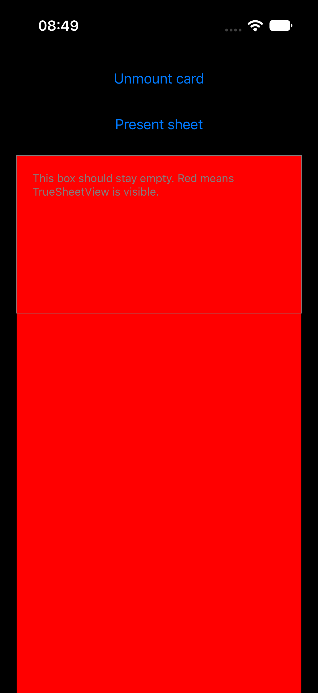
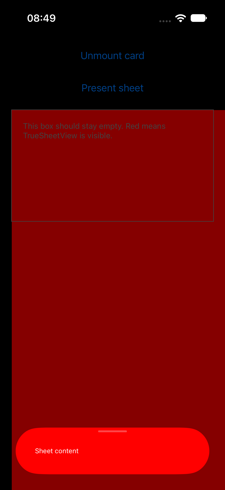
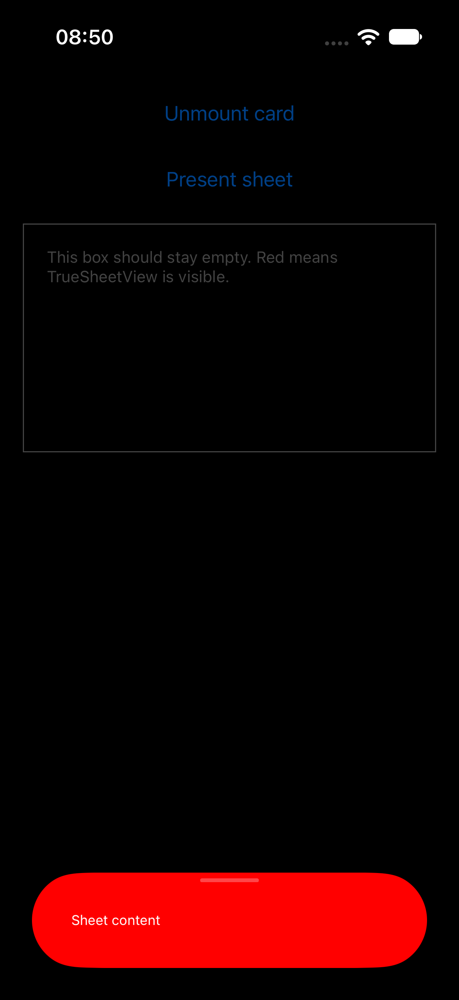

# TrueSheet: hidden `TrueSheetView` becomes visible after view recycling on React Native 0.88 (iOS)

Minimal reproduction for `@lodev09/react-native-true-sheet` on iOS.

- @lodev09/react-native-true-sheet `3.11.18`
- react-native `0.88.0` (New Architecture), react `19.3.0`
- iOS 27.0 simulator (iPhone 17)

## The issue

`TrueSheetView` is a placeholder in the React tree. It's absolutely positioned over its parent
(`StyleSheet.absoluteFill`, `zIndex: -9999`) and hides itself once, when it's created:

```objc
// ios/TrueSheetView.mm
- (instancetype)initWithFrame:(CGRect)frame {
  if (self = [super initWithFrame:frame]) {
    ...
    self.hidden = YES;
```

React Native 0.88 changed how recycled Fabric views are reset
([react/react-native@711a9a5](https://github.com/react/react-native/commit/711a9a5e07),
"reset `EmptyLayoutMetrics` on Fabric view recycle"). `RCTViewComponentView`'s
`prepareForRecycle` now sets `_layoutMetrics = EmptyLayoutMetrics` instead of `{}`. When a
recycled view is mounted again, `-[UIView(ComponentViewProtocol) updateLayoutMetrics:oldLayoutMetrics:]`
sees `EmptyLayoutMetrics` as the old metrics and forces a full update, including:

```objc
if (forceUpdate || (layoutMetrics.displayType != oldLayoutMetrics.displayType)) {
  self.hidden = layoutMetrics.displayType == DisplayType::None;
}
```

This sets `hidden = NO` on the recycled `TrueSheetView`. Nothing hides it again, so it paints its
`backgroundColor` (the sheet's `backgroundColor` prop shares its name with the view style prop)
behind every transparent view in its stacking context. A freshly created `TrueSheetView` isn't
affected, so the bug only shows up once a sheet view has been recycled, and reloading the app
"fixes" it.

On React Native 0.87 and earlier, the reset value was `{}`, the forced update never ran, and the
view stayed hidden.

In a real app, this shows up as screens where sheets are rendered inline (for example, a widget
that renders its own sheet) suddenly getting a solid background in the sheet's colour after
navigating around.

## Steps to reproduce

```sh
npm install
cd ios && pod install && cd ..
npm run ios
```

1. The app starts with a bordered box that contains a `<TrueSheet backgroundColor="red">`. The box
   is empty (correct, because the `TrueSheetView` is a new view and hidden).
2. Tap **Unmount card**. The `TrueSheetView` is unmounted and goes into Fabric's recycle pool.
3. Tap **Mount card**. The recycled `TrueSheetView` is reused.

You can also run the steps with [Maestro](https://maestro.dev): `maestro test maestro/repro.yaml`.

## Expected vs. actual

|                        | Actual                                         | Expected                                         |
| ---------------------- | ---------------------------------------------- | ------------------------------------------------ |
| After step 1           |       |       |
| After step 3 (remount) |     |     |
| Sheet presented        |   |   |

**Actual:** after the remount, the recycled `TrueSheetView` is visible and paints the box (and the
area below it) red.

**Expected:** the box stays empty, as on the first mount.

## Suggested fix

Keep the placeholder view hidden after every layout update. See [`fix.patch`](fix.patch):

```diff
+- (void)updateLayoutMetrics:(const LayoutMetrics &)layoutMetrics
+           oldLayoutMetrics:(const LayoutMetrics &)oldLayoutMetrics {
+  [super updateLayoutMetrics:layoutMetrics oldLayoutMetrics:oldLayoutMetrics];
+
+  // RN 0.88 resets recycled views to EmptyLayoutMetrics, which forces `hidden`
+  // to be derived from displayType on the next mount. This placeholder view
+  // must always stay hidden, since the sheet content is presented elsewhere.
+  self.hidden = YES;
+}
```

The "Expected" screenshots above were taken with this patch applied. Presenting and dismissing
the sheet still works. Opting out of recycling (`+ (BOOL)shouldBeRecycled { return NO; }`) also
works, but it hides the problem rather than fixing it.
